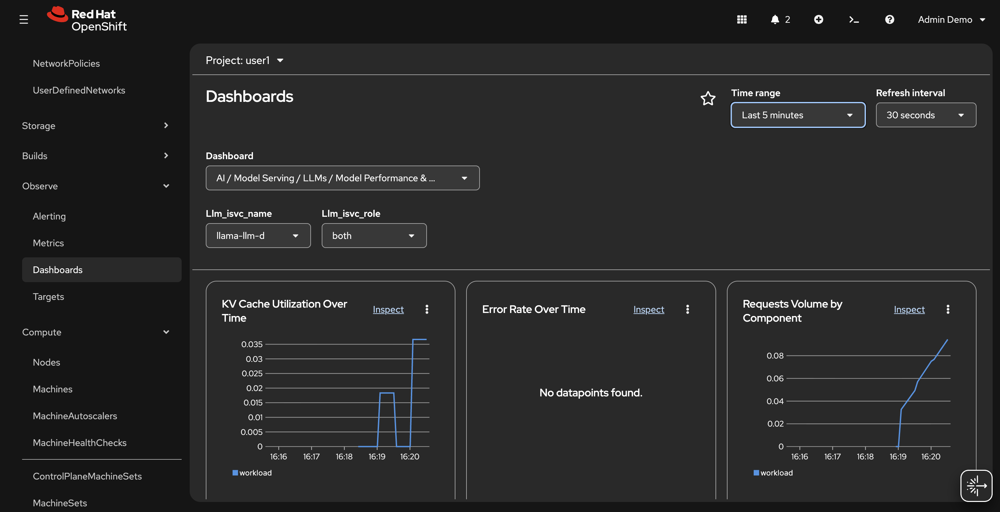

# 🚀 LLMs Distributed Inference

In Red Hat OpenShift AI, distributed inference is powered by the llm-d open-source framework, which serves as an intelligent orchestration layer above model servers like vLLM.

llm-d handles different operational concerns, including runtime-aware scheduling, cache locality optimization, and intelligence across pods and nodes. Merging these into a single monolithic system would couple features that evolve at different speeds. Instead, this layered approach gives platform teams:

* Flexibility: Swap runtimes or schedulers independently.
* Extensibility: Integrate future innovations without redesigning the stack.
* Clarity: Each layer has a clear responsibility.

## Create the LLMInferenceService

1. First of all a GatewayClass and a Gateway for the inference service should be created.

```bash
cat << 'EOF' | oc apply -f-
---
apiVersion: gateway.networking.k8s.io/v1
kind: GatewayClass
metadata:
  name: openshift-default
spec:
  controllerName: openshift.io/gateway-controller/v1
---
apiVersion: gateway.networking.k8s.io/v1
kind: Gateway
metadata:
  name: openshift-ai-inference
  namespace: openshift-ingress
spec:
  gatewayClassName: openshift-default
  listeners:
    - name: http
      port: 80
      protocol: HTTP
      allowedRoutes:
        namespaces:
          from: All
EOF
```

2. Create the llm-d configuration with 2 replicas and prefix-cache-aware routing:

[vLLM manifest LLM-d](_createllmd.md ':include')

3.  Once the LLMInferenceService shows Ready, get the inference URL:

```bash
# Get the llm-d inference URL
LLMD_URL=$(oc get llminferenceservice llama-llm-d -n <USER_NAME> -o jsonpath='{.status.url}')
echo "llm-d URL: ${LLMD_URL}"

# Test with a simple request
curl ${LLMD_URL}/v1/completions \
  -H "Content-Type: application/json" \
  -d '{
    "model": "llama-3-1-8b-instruct-fp8",
    "prompt": "San Francisco is a",
    "max_tokens": 50,
    "temperature": 0.7
  }' | jq .
```

## Monitoring

Red Hat OpenShift AI 3.5 includes built-in observability dashboards for Distributed Inference with llm-d deployments. The dashboards appear in the OpenShift AI Observe & Monitor section and offer pre-built views for monitoring traffic health, latency, and resource utilization without deploying a separate Grafana instance.

For enabling these dashboard, complete the following steps:

1. Create user monitoring stack adding `enableUserWorkload: true` under `data/config.yaml` to enable monitoring for user-defined projects in a cluster:

```bash
oc apply -f - <<EOF                                                
apiVersion: v1
kind: ConfigMap
metadata:
  name: cluster-monitoring-config      
  namespace: openshift-monitoring              
data:
  config.yaml: |
    enableUserWorkload: true
EOF
````

2. Verify that the prometheus-operator, prometheus-user-workload, and thanos-ruler-user-workload pods are running in the openshift-user-workload-monitoring project. It might take a short while for the pods to start:

```bash
oc -n openshift-user-workload-monitoring get pod
```

3. Access to **Openshift Console -> Observe -> Dashboards -> Model Serving LLMs Model Performance Usage**



### Clean-Up

Having explored this powerful solution, you can now proceed to decommission and remove all deployed resources...

```bash
oc delete LLMInferenceService llama-llm-d
```
