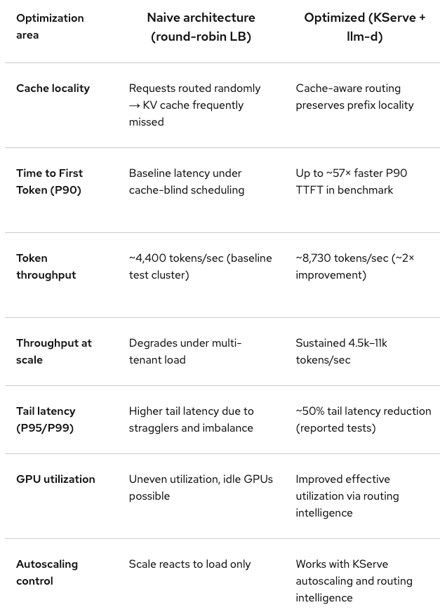

# 🥇 Benchmark

In this module you’ll look at the vLLM metrics endpoint and run a short illustrative benchmark to see how an inference service responses in a high performance scenario.

## Deploy `llama-vllm` model

`modelcar-llama-3-1-8b-instruct-fp8-dynamic` is a highly optimized asset designed specifically for Red Hat Enterprise Linux AI (RHEL AI) and OpenShift AI. Here is a technical breakdown of what is inside this specific image:

* llama-3-1-8b-instruct: The specific version of Meta's model (Llama 3.1, 8 Billion parameters, fine-tuned for instruction following).
* fp8: This is a quantized version. While standard models use FP16 or BF16, FP8 uses 8-bit floating-point precision. It roughly halves the VRAM requirement and speeds up inference significantly on modern hardware (like NVIDIA H100/L4).
* dynamic: This refers to Dynamic Quantization. The model can adjust its precision parameters during runtime to maintain higher accuracy while staying in the 8-bit format.

Now, it is time o create the vLLM based inference service where the magic will happen:

[vLLM manifest](_createvllm.md ':include')

## Explore vLLM metrics endpoint

1. vLLM exposes Prometheus metrics on its metrics port. Verify the service is exposing metrics:

```bash
oc port-forward deployment/llama-vllm-single-predictor 8000:8000 &
```

2. Access to Prometheus metrics:

```bash
curl http://localhost:8000/metrics | grep vllm | head -40
```

The following metrics can be shown in the logs:

```text
# HELP vllm:num_requests_running Number of requests in model execution batches.
# TYPE vllm:num_requests_running gauge
vllm:num_requests_running{engine="0",model_name="llama-vllm-single"} 0.0
# HELP vllm:num_requests_waiting Number of requests waiting to be processed.
# TYPE vllm:num_requests_waiting gauge
vllm:num_requests_waiting{engine="0",model_name="llama-vllm-single"} 0.0
# HELP vllm:kv_cache_usage_perc KV-cache usage. 1 means 100 percent usage.
# TYPE vllm:kv_cache_usage_perc gauge
vllm:kv_cache_usage_perc{engine="0",model_name="llama-vllm-single"} 0.0
# HELP vllm:prefix_cache_queries_total Prefix cache queries, in terms of number of queried tokens.
# TYPE vllm:prefix_cache_queries_total counter
vllm:prefix_cache_queries_total{engine="0",model_name="llama-vllm-single"} 0.0
# HELP vllm:prefix_cache_queries_created Prefix cache queries, in terms of number of queried tokens.
# TYPE vllm:prefix_cache_queries_created gauge
vllm:prefix_cache_queries_created{engine="0",model_name="llama-vllm-single"} 1.7769301736864316e+09
# HELP vllm:prefix_cache_hits_total Prefix cache hits, in terms of number of cached tokens.
# TYPE vllm:prefix_cache_hits_total counter
vllm:prefix_cache_hits_total{engine="0",model_name="llama-vllm-single"} 0.0
# HELP vllm:prefix_cache_hits_created Prefix cache hits, in terms of number of cached tokens.
# TYPE vllm:prefix_cache_hits_created gauge
vllm:prefix_cache_hits_created{engine="0",model_name="llama-vllm-single"} 1.7769301736864555e+09
# HELP vllm:num_preemptions_total Cumulative number of preemption from the engine.
# TYPE vllm:num_preemptions_total counter
vllm:num_preemptions_total{engine="0",model_name="llama-vllm-single"} 0.0
# HELP vllm:num_preemptions_created Cumulative number of preemption from the engine.
# TYPE vllm:num_preemptions_created gauge
vllm:num_preemptions_created{engine="0",model_name="llama-vllm-single"} 1.7769301736864786e+09
# HELP vllm:prompt_tokens_total Number of prefill tokens processed.
# TYPE vllm:prompt_tokens_total counter
vllm:prompt_tokens_total{engine="0",model_name="llama-vllm-single"} 0.0
# HELP vllm:prompt_tokens_created Number of prefill tokens processed.
# TYPE vllm:prompt_tokens_created gauge
vllm:prompt_tokens_created{engine="0",model_name="llama-vllm-single"} 1.7769301736864982e+09
# HELP vllm:generation_tokens_total Number of generation tokens processed.
# TYPE vllm:generation_tokens_total counter
vllm:generation_tokens_total{engine="0",model_name="llama-vllm-single"} 0.0
# HELP vllm:generation_tokens_created Number of generation tokens processed.
# TYPE vllm:generation_tokens_created gauge
vllm:generation_tokens_created{engine="0",model_name="llama-vllm-single"} 1.7769301736865187e+09
# HELP vllm:request_success_total Count of successfully processed requests.
```

?>Stop port-forward when ready executing `pkill -f "port-forward"`

## Run GuideLLM benchmark

This is a short, illustrative run—just 30 seconds per concurrency level—to show how a single GPU handles a large volume of concurrent requests. The goal here is simply to observe what happens when one GPU gets overloaded.

1. Execute a benchmark using a specific and repetible contiguration:

```bash
cat << 'EOF' | oc apply -f-
apiVersion: batch/v1
kind: Job
metadata:
  name: guidellm-vllm-single
  namespace: <USER_NAME>
spec:
  backoffLimit: 0
  ttlSecondsAfterFinished: 86400
  template:
    spec:
      restartPolicy: Never
      containers:
        - name: guidellm
          image: ghcr.io/vllm-project/guidellm:latest
          env:
            - name: GUIDELLM__SPEC__BACKEND
              value: '{"kind": "openai_http", "target": "http://llama-vllm-single-predictor:8000", "model": "llama-vllm-single"}'
            - name: GUIDELLM__SPEC__PROFILE
              value: '{"kind": "concurrent", "streams": [1, 2, 4, 8]}'
            - name: GUIDELLM__SPEC__CONSTRAINTS
              value: '[{"kind": "max_duration", "seconds": 30}]'
            - name: GUIDELLM__SPEC__DATA
              value: '[{"kind": "synthetic_text", "prompt_tokens": 512, "output_tokens": 256}]'
            - name: GUIDELLM__SPEC__TOKENIZER__KIND
              value: "huggingface_auto"
            - name: GUIDELLM__SPEC__TOKENIZER__MODEL
              value: "RedHatAI/Meta-Llama-3.1-8B-Instruct-FP8-dynamic"
            - name: HF_HOME
              value: /tmp/hf-cache
            - name: TRANSFORMERS_CACHE
              value: /tmp/hf-cache
            - name: XDG_CACHE_HOME
              value: /tmp
          volumeMounts:
            - name: cache
              mountPath: /tmp/hf-cache
            - name: results
              mountPath: /results
      volumes:
        - name: cache
          emptyDir: {}
        - name: results
          emptyDir: {}
EOF
```

2. After running the Quick Start benchmark, GuideLLM writes several output files to the directory you specified. Each one focuses on a different layer of analysis, ranging from a quick on-screen summary to fully structured data for dashboards and regression pipelines. The console provides a lightweight summary with high-level statistics for each benchmark in the run. It's useful for quick checks to confirm that the server responded correctly, the load sweep completed, and the system behaved as expected. 

```bash
oc logs -f job/guidellm-vllm-single
```

Example of the output:

```text
ℹ Run Summary Info
|==============|==========|==========|======|======|======|======|=====|=====|========|========|=====|========|========|=====|
| Benchmark    | Timings                              ||||| Requests       ||| Input Tokens        ||| Output Tokens       |||
| Strategy     | Start    | End      | Dur  | Warm | Cool | Comp | Inc | Err | Comp   | Inc    | Err | Comp   | Inc    | Err |
|              |          |          | Sec  | Sec  | Sec  | Tot  | Tot | Tot | Tot    | Tot    | Tot | Tot    | Tot    | Tot |
|--------------|----------|----------|------|------|------|------|-----|-----|--------|--------|-----|--------|--------|-----|
| concurrent@1 | 15:10:19 | 15:10:49 | 30.0 | 0.0  | 0.0  | 3    | 1   | 0   | 1638.0 | 546.0  | 0.0 | 768.0  | 25.0   | 0.0 |
| concurrent@2 | 15:10:56 | 15:11:26 | 30.0 | 0.0  | 0.0  | 6    | 2   | 0   | 3276.0 | 1058.0 | 0.0 | 1536.0 | 1.0    | 0.0 |
| concurrent@4 | 15:11:32 | 15:12:02 | 30.0 | 0.0  | 0.0  | 8    | 4   | 0   | 4368.0 | 2184.0 | 0.0 | 2048.0 | 921.0  | 0.0 |
| concurrent@8 | 15:12:09 | 15:12:39 | 30.0 | 0.0  | 0.0  | 16   | 8   | 0   | 8736.0 | 4368.0 | 0.0 | 4096.0 | 1364.0 | 0.0 |
|==============|==========|==========|======|======|======|======|=====|=====|========|========|=====|========|========|=====|


ℹ Text Metrics Statistics (Completed Requests)
|==============|=======|=======|=======|=======|=======|=======|=======|=======|========|========|========|========|
| Benchmark    | Input Tokens               |||| Input Words                |||| Input Characters               ||||
| Strategy     | Per Request  || Per Second   || Per Request  || Per Second   || Per Request    || Per Second     ||
|              | Mdn   | p95   | Mdn   | Mean  | Mdn   | p95   | Mdn   | Mean  | Mdn    | p95    | Mdn    | Mean   |
|--------------|-------|-------|-------|-------|-------|-------|-------|-------|--------|--------|--------|--------|
| concurrent@1 | 546.0 | 546.0 | 114.0 | 85.5  | 426.0 | 431.0 | 88.3  | 66.8  | 2902.0 | 2917.0 | 587.9  | 450.9  |
| concurrent@2 | 546.0 | 546.0 | 110.0 | 164.6 | 426.0 | 433.0 | 85.7  | 128.6 | 2874.0 | 2896.0 | 578.3  | 862.0  |
| concurrent@4 | 546.0 | 546.0 | 316.8 | 420.7 | 424.0 | 432.0 | 246.8 | 327.8 | 2800.0 | 2914.0 | 1640.4 | 2179.7 |
| concurrent@8 | 546.0 | 546.0 | 99.3  | 750.2 | 427.0 | 432.0 | 78.4  | 587.2 | 2834.0 | 2923.0 | 524.8  | 3894.8 |
|==============|=======|=======|=======|=======|=======|=======|=======|=======|========|========|========|========|
| Benchmark    | Output Tokens              |||| Output Words               |||| Output Characters              ||||
| Strategy     | Per Request  || Per Second   || Per Request  || Per Second   || Per Request    || Per Second     ||
|              | Mdn   | p95   | Mdn   | Mean  | Mdn   | p95   | Mdn   | Mean  | Mdn    | p95    | Mdn    | Mean   |
|--------------|-------|-------|-------|-------|-------|-------|-------|-------|--------|--------|--------|--------|
| concurrent@1 | 256.0 | 256.0 | 53.5  | 40.1  | 182.0 | 205.0 | 32.8  | 28.4  | 1258.0 | 1262.0 | 231.8  | 189.6  |
| concurrent@2 | 256.0 | 256.0 | 51.6  | 77.2  | 177.0 | 202.0 | 38.9  | 53.9  | 1214.0 | 1307.0 | 255.3  | 362.8  |
| concurrent@4 | 256.0 | 256.0 | 148.5 | 197.3 | 191.0 | 224.0 | 114.9 | 147.3 | 1200.0 | 1426.0 | 751.9  | 976.6  |
| concurrent@8 | 256.0 | 256.0 | 46.5  | 351.8 | 188.0 | 225.0 | 34.2  | 253.0 | 1187.0 | 1479.0 | 224.5  | 1637.0 |
|==============|=======|=======|=======|=======|=======|=======|=======|=======|========|========|========|========|


ℹ Request Token Statistics (Completed Requests)
|==============|=======|=======|=======|=======|=======|=======|=======|=======|=========|========|
| Benchmark    | Input Tok    || Output Tok   || Total Tok    || Stream Iter  || Output Tok      ||
| Strategy     | Per Req      || Per Req      || Per Req      || Per Req      || Per Stream Iter ||
|              | Mdn   | p95   | Mdn   | p95   | Mdn   | p95   | Mdn   | p95   | Mdn     | p95    |
|--------------|-------|-------|-------|-------|-------|-------|-------|-------|---------|--------|
| concurrent@1 | 546.0 | 546.0 | 256.0 | 256.0 | 802.0 | 802.0 | 259.0 | 259.0 | 1.0     | 1.0    |
| concurrent@2 | 546.0 | 546.0 | 256.0 | 256.0 | 802.0 | 802.0 | 259.0 | 259.0 | 1.0     | 1.0    |
| concurrent@4 | 546.0 | 546.0 | 256.0 | 256.0 | 802.0 | 802.0 | 259.0 | 259.0 | 1.0     | 1.0    |
| concurrent@8 | 546.0 | 546.0 | 256.0 | 256.0 | 802.0 | 802.0 | 259.0 | 259.0 | 1.0     | 1.0    |
|==============|=======|=======|=======|=======|=======|=======|=======|=======|=========|========|


ℹ Request Latency Statistics (Completed Requests)
|==============|=============|======|=======|===============|=======|========|===============|=======|========|======|======|======|======|======|======|
| Benchmark    | Request Latency          ||| TTFT                         ||| TTFOT                        ||| ITL              ||| TPOT             |||
| Strategy     | Sec                      ||| ms                           ||| ms                           ||| ms               ||| ms               |||
|              | Mean        | Mdn  | p95   | Mean          | Mdn   | p95    | Mean          | Mdn   | p95    | Mean | Mdn  | p95  | Mean | Mdn  | p95  |
|--------------|-------------|------|-------|---------------|-------|--------|---------------|-------|--------|------|------|------|------|------|------|
| concurrent@1 | 9.7 ± 0.4   | 9.6  | 9.8*  | 201.6 ± 380.6 | 122.1 | 378.2* | 201.6 ± 380.6 | 122.1 | 378.2* | 37.1 | 37.1 | 37.1 | 37.7 | 37.4 | 38.4 |
| concurrent@2 | 9.9 ± 0.02  | 9.9  | 9.9*  | 192.1 ± 59.9  | 152.8 | 245.2* | 192.1 ± 59.9  | 152.8 | 245.2* | 38.1 | 38.0 | 38.4 | 38.7 | 38.8 | 38.8 |
| concurrent@4 | 10.3 ± 0.01 | 10.3 | 10.3* | 350.3 ± 109.1 | 418.8 | 423.1* | 350.3 ± 109.1 | 418.8 | 423.1* | 39.2 | 38.9 | 39.9 | 40.4 | 40.4 | 40.4 |
| concurrent@8 | 11.2 ± 0.05 | 11.2 | 11.5* | 573.5 ± 118.4 | 509.1 | 810.1* | 573.5 ± 118.4 | 509.1 | 810.1* | 41.7 | 41.7 | 43.1 | 43.7 | 43.6 | 44.8 |
|==============|=============|======|=======|===============|=======|========|===============|=======|========|======|======|======|======|======|======|
* confidence interval unavailable at this sample size


ℹ Server Throughput Statistics (All Requests)
|==============|=======|======|=========|==============|===============|==============|
| Benchmark    | Requests             ||| Input Tokens | Output Tokens | Total Tokens |
| Strategy     | Concurrency || Per Sec | Per Sec      | Per Sec       | Per Sec      |
|              | Mdn   | Mean | Mean                                               ||||
|--------------|-------|------|---------|--------------|---------------|--------------|
| concurrent@1 | 1.0   | 1.0  | 0.1     | 72.8         | 26.4          | 99.2         |
| concurrent@2 | 2.0   | 2.0  | 0.2     | 127.4        | 51.2          | 178.6        |
| concurrent@4 | 4.0   | 4.0  | 0.3     | 218.4        | 98.8          | 317.2        |
| concurrent@8 | 8.0   | 8.0  | 0.5     | 436.8        | 181.9         | 618.7        |
|==============|=======|======|=========|==============|===============|==============|


Warnings (concurrent@1)
⚠ mean generation delay was 2% of mean time to first token ms.total (0.003s /   
  0.181s; threshold 1%).                                                        
  This means that the benchmark was likely bottlenecked by the data generation. 


✔ Benchmarking complete, generated 4 benchmark(s)
…   json    : /results/benchmarks.json
…   csv     : /results/benchmarks.csv

```

## Compare GuideLLM benchmark - Multiple Replicas

1. Now, it is time to increase the inference server replicas in order to try to improve our inference service performance. To do so, please execute the following command:

```bash
oc patch inferenceservice llama-vllm-single -n <USER_NAME> --type=merge -p '{
  "spec": {
    "predictor": {
      "minReplicas": 2,
      "maxReplicas": 2
    }
  }
}'
```

2. Wait for the new inference service pod is ready:

```bash
oc get pods -n <USER_NAME> -l serving.kserve.io/inferenceservice=llama-vllm-single
```

3. Now, execute a new benchmark using the same previous parameters:

```bash
cat << 'EOF' | oc apply -f-
apiVersion: batch/v1
kind: Job
metadata:
  name: guidellm-vllm-single-2-replicas
  namespace: <USER_NAME>
spec:
  backoffLimit: 0
  ttlSecondsAfterFinished: 86400
  template:
    spec:
      restartPolicy: Never
      containers:
        - name: guidellm
          image: ghcr.io/vllm-project/guidellm:latest
          env:
            - name: GUIDELLM__SPEC__BACKEND
              value: '{"kind": "openai_http", "target": "http://llama-vllm-single-predictor:8000", "model": "llama-vllm-single"}'
            - name: GUIDELLM__SPEC__PROFILE
              value: '{"kind": "concurrent", "streams": [1, 2, 4, 8]}'
            - name: GUIDELLM__SPEC__CONSTRAINTS
              value: '[{"kind": "max_duration", "seconds": 30}]'
            - name: GUIDELLM__SPEC__DATA
              value: '[{"kind": "synthetic_text", "prompt_tokens": 512, "output_tokens": 256}]'
            - name: GUIDELLM__SPEC__TOKENIZER__KIND
              value: "huggingface_auto"
            - name: GUIDELLM__SPEC__TOKENIZER__MODEL
              value: "RedHatAI/Meta-Llama-3.1-8B-Instruct-FP8-dynamic"
            - name: HF_HOME
              value: /tmp/hf-cache
            - name: TRANSFORMERS_CACHE
              value: /tmp/hf-cache
            - name: XDG_CACHE_HOME
              value: /tmp
          volumeMounts:
            - name: cache
              mountPath: /tmp/hf-cache
            - name: results
              mountPath: /results
      volumes:
        - name: cache
          emptyDir: {}
        - name: results
          emptyDir: {}
EOF
```

4. After running the Quick Start benchmark, review the new performance metrics this time. 

```bash
oc logs -f job/guidellm-vllm-single-2-replicas
```

> SPOILER: You will see similar performance metric, due to using two replicas are not improving the performance metrics

[vLLM manifest delete](_deletevllm.md ':include')

## Compare GuideLLM benchmark - LLM-d

You’ve established that 2 GPUs with naive scaling that doesn’t significantly reduce P95 tail latency. Now, you deploy a llm-d’s prefix-cache-aware routing on the same hardware and run the identical benchmark.

In terms of comparation with the previous inference service, the model remained the same but the performance gains came from the orchestration and routing logic of the system.



1. Create now the LLM-d distributed inference service to test this solution:

[vLLM manifest LLM-d](_createllmd.md ':include')

The three routing plugins and their weights:
- `prefix-cache-scorer (weight 3)` -> Routes requests to the backend with the highest KV cache match for this prompt prefix — the primary tail-latency reducer
- `queue-scorer (weight 2)` -> Balances queue depth across replicas
- `active-request-scorer (weight 2)` -> Considers in-flight request count

2. Extrat the LLM-d inference service URL:

```bash
oc get llminferenceservice llama-llm-d -n <USER_NAME> -o jsonpath='{.status.url}'
```

3. Run the exact same GuideLLM configuration including the respective LLM-d inference service URL: 

!> IMPORTANT: Replace ${LLMD_URL} for the URL

```bash
cat << 'EOF' | oc apply -f-
apiVersion: batch/v1
kind: Job
metadata:
  name: guidellm-llm-d
  namespace: user1
#  namespace: <USER_NAME>
spec:
  backoffLimit: 0
  ttlSecondsAfterFinished: 86400
  template:
    spec:
      restartPolicy: Never
      containers:
        - name: guidellm
          image: ghcr.io/vllm-project/guidellm:latest
          env:
            - name: GUIDELLM__SPEC__BACKEND
              value: '{"kind": "openai_http", "target": "http://ad73cfa8ab65b4aa2bed08540314ff8e-1408741115.us-east-2.elb.amazonaws.com/user1/llama-llm-d", "model": "llama-3-1-8b-instruct-fp8"}'  # <-------------------------------- Replace HERE !!!${LLMD_URL}
              value: '{"kind": "openai_http", "target": "${LLMD_URL}", "model": "llama-3-1-8b-instruct-fp8"}'  # <-------------------------------- Replace HERE !!!
            - name: GUIDELLM__SPEC__PROFILE
              value: '{"kind": "concurrent", "streams": [1, 2, 4, 8]}'
            - name: GUIDELLM__SPEC__CONSTRAINTS
              value: '[{"kind": "max_duration", "seconds": 30}]'
            - name: GUIDELLM__SPEC__DATA
              value: '[{"kind": "synthetic_text", "prompt_tokens": 512, "output_tokens": 256}]'
            - name: GUIDELLM__SPEC__TOKENIZER__KIND
              value: "huggingface_auto"
            - name: GUIDELLM__SPEC__TOKENIZER__MODEL
              value: "RedHatAI/Meta-Llama-3.1-8B-Instruct-FP8-dynamic"
            - name: HF_HOME
              value: /tmp/hf-cache
            - name: TRANSFORMERS_CACHE
              value: /tmp/hf-cache
            - name: XDG_CACHE_HOME
              value: /tmp
          volumeMounts:
            - name: cache
              mountPath: /tmp/hf-cache
            - name: results
              mountPath: /results
      volumes:
        - name: cache
          emptyDir: {}
        - name: results
          emptyDir: {}
EOF
```

3. After running the Quick Start benchmark, review the new performance metrics this time. 

```bash
oc logs -f job/guidellm-llm-d
```

> QUESTION: Do you see any performance improvement using LLM-d?

?>Review [guidellm](https://github.com/vllm-project/guidellm/blob/main/docs/guides/datasets.md) documentation to know more about DATASETs and syntatic data generation.

