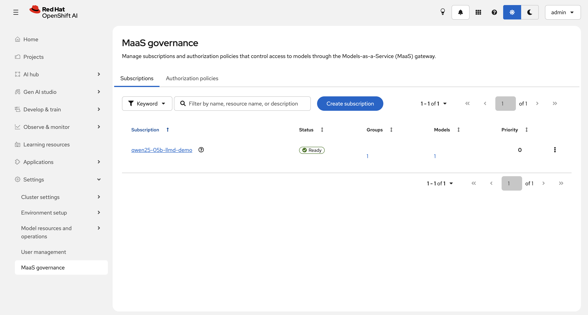
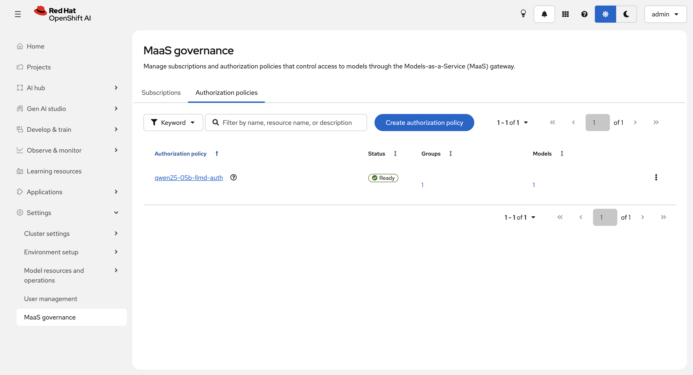
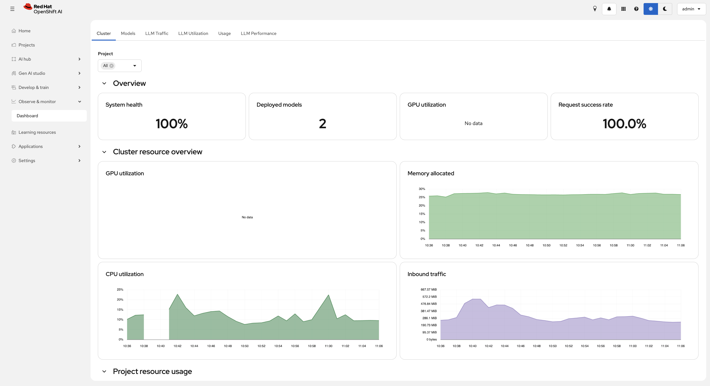
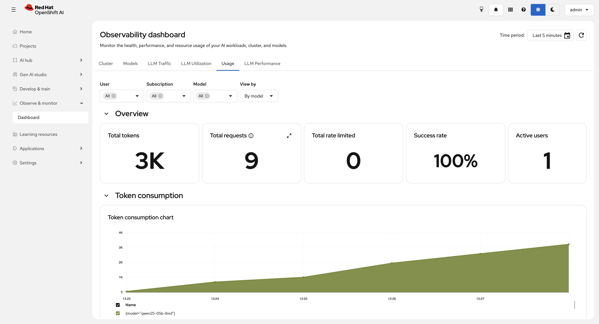

# 📊 Observability and monitoring

This lab checks that usage from the model calls in the previous sections is collected, then reviews those same objects in the OpenShift AI console.

The MaaS usage dashboard is a Technology Preview in Red Hat OpenShift AI 3.5. The numbers are for showback. They are not a billing meter.

Complete the configuration, deployment, subscription, and API key labs first. Those labs create:

| Kind | Name | Namespace |
| --- | --- | --- |
| LLMInferenceService | `qwen25-05b-llmd` | `project01-model-deploy` |
| MaaSSubscription | `qwen25-05b-llmd-demo` | `models-as-a-service` |
| MaaSAuthPolicy | `qwen25-05b-llmd-auth` | `models-as-a-service` |
| MaasTenantConfig | `default-tenant` | `models-as-a-service` |

The configuration lab already enables user workload monitoring, Kuadrant observability, the dashboard flags `modelAsService` and `observabilityDashboard`, and `captureUser` on `default-tenant`. The **Usage** tab also needs the Cluster Observability Operator, which provides the Perses dashboards the page renders, and the Red Hat build of OpenTelemetry, which provides the collector for the OpenShift AI monitoring stack.

## Install the Cluster Observability Operator

Install the operator from the `stable` channel into `openshift-cluster-observability-operator`. The install mode is all namespaces. The namespace label `openshift.io/cluster-monitoring: "true"` is the console option **Enable Operator recommended cluster monitoring on this Namespace**.

1. Check whether the operator is already installed:

```bash
oc get csv -n openshift-cluster-observability-operator \
  -o custom-columns=NAME:.metadata.name,VERSION:.spec.version,PHASE:.status.phase \
  | grep '^cluster-observability-operator'
```

When the phase is `Succeeded`, continue at **Install the Red Hat build of OpenTelemetry**. Apply the manifests below when the command prints nothing or the phase is not `Succeeded`.

2. Create the namespace, the all-namespaces OperatorGroup, and the Subscription:

```bash
cat << 'EOF' | oc apply -f-
apiVersion: v1
kind: Namespace
metadata:
  name: openshift-cluster-observability-operator
  labels:
    openshift.io/cluster-monitoring: "true"
---
apiVersion: operators.coreos.com/v1
kind: OperatorGroup
metadata:
  name: cluster-observability-operator
  namespace: openshift-cluster-observability-operator
spec: {}
---
apiVersion: operators.coreos.com/v1alpha1
kind: Subscription
metadata:
  name: cluster-observability-operator
  namespace: openshift-cluster-observability-operator
spec:
  channel: stable
  installPlanApproval: Automatic
  name: cluster-observability-operator
  source: redhat-operators
  sourceNamespace: openshift-marketplace
EOF
```

?> 📎 Create the OperatorGroup only when the namespace does not already have one. A second OperatorGroup in the same namespace makes the install fail. If `oc get operatorgroup -n openshift-cluster-observability-operator` already lists a group, apply the Namespace and the Subscription and leave that group in place.

3. Wait until the ClusterServiceVersion reports `Succeeded`:

```bash
oc get csv -n openshift-cluster-observability-operator \
  -o custom-columns=NAME:.metadata.name,VERSION:.spec.version,PHASE:.status.phase \
  | grep '^cluster-observability-operator'
```

Expected output (the patch version can differ):

```text
cluster-observability-operator.v1.5.5   1.5.5   Succeeded
```

4. Confirm the operator deployments are available:

```bash
oc get deploy -n openshift-cluster-observability-operator
```

?> ✅ `observability-operator` and `perses-operator` are `Available`. The namespace also runs the Prometheus operator deployments that belong to this operator.

## Install the Red Hat build of OpenTelemetry

Install the operator from the `stable` channel into `openshift-opentelemetry-operator`. The catalog package name is `opentelemetry-product`. The install mode is all namespaces, and the namespace uses the same cluster-monitoring label as the Cluster Observability Operator.

1. Check whether the operator is already installed:

```bash
oc get csv -n openshift-opentelemetry-operator \
  -o custom-columns=NAME:.metadata.name,VERSION:.spec.version,PHASE:.status.phase \
  | grep '^opentelemetry-operator'
```

When the phase is `Succeeded`, continue at **Confirm collection**. Apply the manifests below when the command prints nothing or the phase is not `Succeeded`.

2. Create the namespace, the all-namespaces OperatorGroup, and the Subscription:

```bash
cat << 'EOF' | oc apply -f-
apiVersion: v1
kind: Namespace
metadata:
  name: openshift-opentelemetry-operator
  labels:
    openshift.io/cluster-monitoring: "true"
---
apiVersion: operators.coreos.com/v1
kind: OperatorGroup
metadata:
  name: opentelemetry-product
  namespace: openshift-opentelemetry-operator
spec: {}
---
apiVersion: operators.coreos.com/v1alpha1
kind: Subscription
metadata:
  name: opentelemetry-product
  namespace: openshift-opentelemetry-operator
spec:
  channel: stable
  installPlanApproval: Automatic
  name: opentelemetry-product
  source: redhat-operators
  sourceNamespace: openshift-marketplace
EOF
```

?> 📎 Create the OperatorGroup only when the namespace does not already have one. If `oc get operatorgroup -n openshift-opentelemetry-operator` already lists a group, apply the Namespace and the Subscription and leave that group in place.

3. Wait until the ClusterServiceVersion reports `Succeeded`:

```bash
oc get csv -n openshift-opentelemetry-operator \
  -o custom-columns=NAME:.metadata.name,VERSION:.spec.version,PHASE:.status.phase \
  | grep '^opentelemetry-operator'
```

Expected output (the build date in the version can differ):

```text
opentelemetry-operator.v0.158.0-202611041238   0.158.0-202611041238   Succeeded
```

4. Confirm the operator deployments are available:

```bash
oc get deploy -n openshift-opentelemetry-operator
```

?> ✅ `opentelemetry-operator-controller-manager` is `1/1` and `opentelemetry-operator-webhook` is `2/2`.

## Confirm collection

1. Confirm user workload monitoring is on:

```bash
oc get configmap cluster-monitoring-config -n openshift-monitoring -o yaml | grep enableUserWorkload
oc get pods -n openshift-user-workload-monitoring
```

`enableUserWorkload` is `true`. `prometheus-user-workload` and `thanos-ruler-user-workload` are running, and every container is ready.

2. Confirm Kuadrant is scraping Limitador:

```bash
oc get kuadrant kuadrant -n kuadrant-system -o jsonpath='{.spec.observability.enable}{"\n"}'
oc get podmonitor kuadrant-limitador-monitor -n kuadrant-system
```

Expected output:

```text
true
NAME                         AGE
kuadrant-limitador-monitor   1h
```

3. Confirm the OpenShift AI dashboard shows MaaS governance and the usage dashboard:

```bash
oc get odhdashboardconfig odh-dashboard-config -n redhat-ods-applications \
  -o jsonpath='modelAsService={.spec.dashboardConfig.modelAsService}{"\n"}observabilityDashboard={.spec.dashboardConfig.observabilityDashboard}{"\n"}'
```

Expected output:

```text
modelAsService=true
observabilityDashboard=true
```

## Confirm tenant telemetry

The configuration lab sets `spec.telemetry` on `MaasTenantConfig` `default-tenant` with `captureUser: true`. The **Usage** tab queries `authorized_hits_total{user!=""}` and ignores every series that has no `user` label. Confirm the setting before the chat requests below. Apply the patch when `user` is not `true`.

1. Set those values when the read-back is not `user=true`:

```bash
oc patch maastenantconfigs.maas.opendatahub.io default-tenant -n models-as-a-service --type=merge -p '{
  "spec": {
    "telemetry": {
      "enabled": true,
      "metrics": {
        "captureOrganization": true,
        "captureUser": true,
        "captureGroup": false,
        "captureModelUsage": true
      }
    }
  }
}'
```

2. Read the setting back:

```bash
oc get maastenantconfigs.maas.opendatahub.io default-tenant -n models-as-a-service \
  -o jsonpath='enabled={.spec.telemetry.enabled}{"\n"}model={.spec.telemetry.metrics.captureModelUsage}{"\n"}user={.spec.telemetry.metrics.captureUser}{"\n"}'
```

Expected output:

```text
enabled=true
model=true
user=true
```

3. Confirm the gateway policy now emits the user label:

```bash
oc get telemetrypolicies.extensions.kuadrant.io maas-telemetry -n openshift-ingress \
  -o jsonpath='{.spec.metrics.default.labels.user}{"\n"}'
```

Expected output:

```text
auth.identity.userid
```

?> ✅ `user` is `true` and the policy label is `auth.identity.userid`. Chat calls from the deployment, subscription, and API key labs keep the `user` label when this was set before those calls. A call sent while `captureUser` was false stays on a series the **Usage** tab ignores.

## Record requests

Send ten chat completions on the inference URL. Each call asks for up to 256 completion tokens, so the gateway records ten requests and a much larger `usage.total_tokens` total against `qwen25-05b-llmd-demo`. The subscription limit is 5,000,000 tokens per minute, so these calls stay admitted.

```bash
MODEL_URL=$(oc get llminferenceservice qwen25-05b-llmd -n project01-model-deploy -o jsonpath='{.status.url}')
TOKEN=$(oc whoami -t)
TOTAL=0

for i in {1..10}; do
  TOKENS=$(curl -ksS -X POST "${MODEL_URL}/v1/chat/completions" \
    -H "Authorization: Bearer ${TOKEN}" \
    -H "Content-Type: application/json" \
    -d '{
      "model": "qwen25-05b-llmd",
      "messages": [
        {"role": "user", "content": "Explain what Red Hat OpenShift is, how projects and operators work, and how a model is served on the cluster. Give a detailed answer."}
      ],
      "max_tokens": 256
    }' | jq -r '.usage.total_tokens')
  TOTAL=$((TOTAL + TOKENS))
  echo "request ${i}: total_tokens=${TOKENS} running_total=${TOTAL}"
done
```

Expected output (token counts vary with the completion):

```text
request 1: total_tokens=281 running_total=281
request 2: total_tokens=274 running_total=555
request 3: total_tokens=268 running_total=823
...
request 10: total_tokens=290 running_total=2784
```

?> ✅ Every line prints a `total_tokens` value greater than 0, and `running_total` grows on each request. Wait about a minute before querying Prometheus so the scrape includes these requests.

## Query the metrics

Limitador publishes the counters. User workload Prometheus scrapes them through `kuadrant-limitador-monitor`.

| Metric | What it counts | Useful labels |
| --- | --- | --- |
| `authorized_calls` | Requests admitted by the token limit | `limitador_namespace`, `subscription` |
| `authorized_hits` | Tokens counted against the limit | `limitador_namespace`, `subscription`, `model` |
| `limited_calls` | Requests rejected with HTTP 429 | `limitador_namespace` |

The series for this model uses `limitador_namespace="project01-model-deploy/qwen25-05b-llmd-kserve-route"`.

1. Query admitted calls and counted tokens:

```bash
THANOS=$(oc get route thanos-querier -n openshift-monitoring -o jsonpath='{.spec.host}')

curl -ksS -H "Authorization: Bearer $(oc whoami -t)" \
  --data-urlencode 'query=sum by (subscription) (authorized_hits{limitador_namespace="project01-model-deploy/qwen25-05b-llmd-kserve-route"})' \
  "https://${THANOS}/api/v1/query" | jq '.data.result'
```

?> ✅ The result lists `qwen25-05b-llmd-demo` with a token total that includes the ten calls. An empty `result` means the scrape has not landed yet. Run the chat loop again, wait one minute, and repeat the query. If the name is still absent, list what Limitador exported:

```bash
curl -ksS -H "Authorization: Bearer $(oc whoami -t)" \
  --data-urlencode 'query={__name__=~"authorized_.*"}' \
  "https://${THANOS}/api/v1/query" | jq '[.data.result[].metric.__name__] | unique'
```

2. Query rejected calls:

```bash
curl -ksS -H "Authorization: Bearer $(oc whoami -t)" \
  --data-urlencode 'query=limited_calls{limitador_namespace="project01-model-deploy/qwen25-05b-llmd-kserve-route"}' \
  "https://${THANOS}/api/v1/query" | jq '.data.result'
```

`limited_calls` appears after a request is rejected with HTTP 429. The limit on `qwen25-05b-llmd-demo` is 5,000,000 tokens per minute, so the ten chat requests in this lab are admitted and this query can be empty.

The same series are visible in the OpenShift console under **Observe** → **Metrics**.

## Review MaaS in the OpenShift AI console

Open the dashboard as a cluster administrator. The host is the data-science gateway route:

```bash
CLUSTER_DOMAIN=$(oc get ingresses.config.openshift.io cluster -o jsonpath='{.spec.domain}')
echo "https://data-science-gateway.${CLUSTER_DOMAIN}"
```

### Subscriptions and authorization

1. Click **Settings** → **MaaS governance**. The **Subscriptions** tab is selected.
2. Find `qwen25-05b-llmd-demo`.



| Column | Value in this lab |
| --- | --- |
| Status | `Ready` |
| Groups | `1` |
| Models | `1` |
| Priority | `0` |

3. Click the subscription name and confirm the group `system:authenticated:oauth`, the model `qwen25-05b-llmd` in `project01-model-deploy`, and the limit of `5000000` tokens per `1m`.
4. Open the **Authorization policies** tab.
5. Find `qwen25-05b-llmd-auth`. The badge is `Ready`. The group is `system:authenticated:oauth`, and the model is `qwen25-05b-llmd` in `project01-model-deploy`.



?> ✅ These rows are the `MaaSSubscription` and `MaaSAuthPolicy` applied in the deployment lab. A `Failed` status is the same condition you read with `oc get` in the subscription and API key labs.

### Usage dashboard

1. Click **Observe & monitor** → **Dashboard**. The **Cluster** tab is selected.



2. Open the **Usage** tab. The bar also includes **Models**, **LLM Traffic**, **LLM Utilization**, and **LLM Performance**. MaaS token usage is on **Usage**.



3. Set **Time period** to **Last 1 hour**.
4. Set **Subscription** to `qwen25-05b-llmd-demo`. Leave **User** and **Model** on **All** unless you want to narrow the view.
5. Read the overview: **Total Tokens**, **Total Requests**, **Total Errors**, **Success Rate**, and **Active Users**.
6. In **Token Consumption by User**, confirm a row for user `admin` (the `oc whoami` identity), subscription `qwen25-05b-llmd-demo`, and model `qwen25-05b-llmd`. **Requests** is at least 10. **Tokens** is in the same range as `running_total` from the chat loop. The panels count the increase during the selected period. Wait one minute and reload when the row is still zero. **Rate Limited** stays at zero while calls stay under 5,000,000 tokens per minute. Set **Time period** so it includes the limit exercise in the subscription lab: **Rate Limited** is greater than zero for `admin` and matches those HTTP `429` responses.

?> ✅ Hover the token table and click **Export as CSV** to download the rows for the selected period and filters. The file is the showback export for this subscription.

## When the Usage tab is empty

| Check | Command | Expected |
| --- | --- | --- |
| The chat loop has completed | inference loop in this lab | ten lines, each `total_tokens` greater than 0, and a growing `running_total` |
| User workload monitoring | `oc get pods -n openshift-user-workload-monitoring` | `prometheus-user-workload` ready |
| Limitador scrape | `oc get podmonitor kuadrant-limitador-monitor -n kuadrant-system` | the PodMonitor exists |
| Kuadrant observability | `oc get kuadrant kuadrant -n kuadrant-system -o jsonpath='{.spec.observability.enable}'` | `true` |
| Tenant telemetry | `oc get maastenantconfig default-tenant -n models-as-a-service -o jsonpath='{.spec.telemetry.enabled}'` | `true` |
| User label | `oc get maastenantconfig default-tenant -n models-as-a-service -o jsonpath='{.spec.telemetry.metrics.captureUser}'` | `true`. The **Usage** tab queries `authorized_hits_total{user!=""}` and ignores series that have no `user` label. |
| Dashboard flag | `oc get odhdashboardconfig odh-dashboard-config -n redhat-ods-applications -o jsonpath='{.spec.dashboardConfig.observabilityDashboard}'` | `true` |
| Cluster Observability Operator | `oc get csv -n openshift-cluster-observability-operator -o custom-columns=NAME:.metadata.name,PHASE:.status.phase \| grep '^cluster-observability-operator'` | `Succeeded` |
| Red Hat build of OpenTelemetry | `oc get csv -n openshift-opentelemetry-operator -o custom-columns=NAME:.metadata.name,PHASE:.status.phase \| grep '^opentelemetry-operator'` | `Succeeded` |

The **Usage** tab is limited to cluster administrators. If the tab is missing, confirm `observabilityDashboard` is `true` and reload the dashboard.
